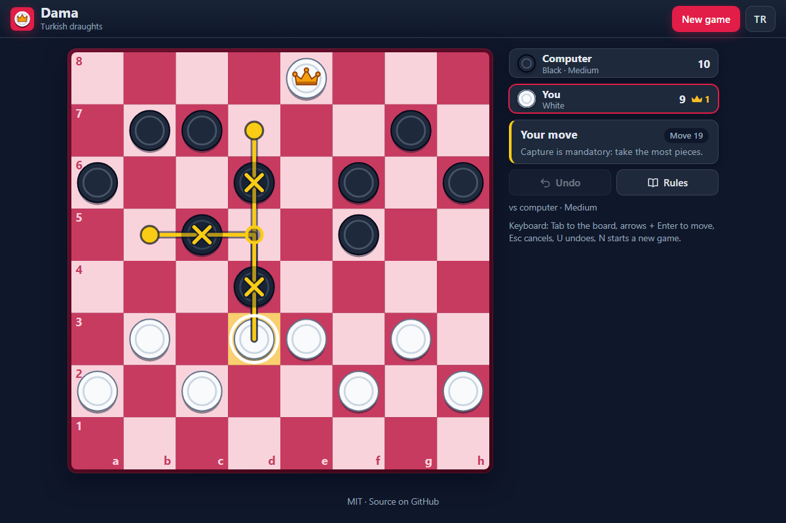

# Dama - Turkish draughts in the browser, with flying kings, forced maximum captures and a computer opponent

[](#tests)
[](LICENSE)

**▶ Play now: https://celaldrg.github.io/dama/**



## Features

- Full Turkish draughts rules: men move forward and sideways, kings fly along ranks and files, capturing is mandatory and the longest capture must be taken.
- Play against the computer (easy, medium or hard, as White or Black) or with two players on one device.
- The computer runs an alpha-beta search in a Web Worker, so the page never freezes while it thinks.
- Pieces that must capture glow, the whole capture route is drawn and the pieces it takes are crossed out.
- Captures are animated hop by hop; animations are skipped when the system asks for reduced motion.
- Undo, New game, move counter, last move and a Rules dialog that explains every rule, including the two draw rules.
- English and Turkish interface; the chosen language and game settings are remembered.
- Works on phones and desktops: tap, drag or play with the keyboard.
- Vanilla HTML, CSS and JavaScript modules: no build step, no dependencies, no external requests.

## How to play

**Touch or mouse**

- Tap one of your pieces, then a highlighted square, or drag the piece onto the square.
- When a capture is possible you must take the route that captures the most pieces. If several routes end on the same square, tap the landing squares one by one.
- Undo takes back your last move (against the computer, its reply too). New game lets you pick the mode, level and color.

**Keyboard**

| Key | Action |
| --- | --- |
| Tab | focus the board |
| Arrow keys | move the cursor |
| Enter / Space | pick a piece, then a square |
| Esc | cancel the selection |
| U | undo |
| N | new game |

**Rules in short:** a man moves one square forward or sideways and captures by jumping an adjacent piece in those directions. A man that reaches the last rank becomes a king, which moves and captures any distance along ranks and files. You win when your opponent has no pieces or no legal move. The game is drawn when the same position with the same player to move appears for the third time, or after 50 moves by each side without a capture or a man move.

## Run locally

```sh
npx serve .
```

Then open the address it prints (usually http://localhost:3000). The game uses ES modules, which browsers only load over `http://`, so opening `index.html` straight from disk does not work. Any static server will do. Add `?demo` to the address to open a fixed mid-game position.

## Tests

```sh
node --test
```

Node 22 or newer, no dependencies. The suites cover:

- **rules**: steps, single and multi-captures, the maximum-capture rule, flying kings (distance captures, landing squares, no 180° turns), promotion during a capture, capture routes that reach the same position, make/unmake moves.
- **game**: turns, illegal input, playing any route of a capture, undo, wins by capture or blockade, threefold repetition and the 50-move rule, the demo position.
- **ai**: legal moves at every level, seeded determinism, tactical choices, and 200 seeded computer-vs-computer games that all finish (the long game tests stop at their timeout instead of hanging if the rules break).
- **selection**: taps and drops resolve to the right move, and every legal route, including different routes to the same position, can be entered by tapping its landing squares.
- **session, i18n, storage**: settings, undo depth, status texts, English/Turkish key parity (including every key used by the page), and storage that is missing, full or blocked.

## Project structure

```
index.html         page, meta tags and dialogs
style.css          dark theme, responsive layout
src/
  rules.js         board, move generation and captures (pure)
  game.js          game state, undo, win and draw rules (pure)
  ai.js            alpha-beta computer player (pure)
  rng.js           seeded random numbers (pure)
  demo.js          the ?demo position (pure)
  selection.js     tap and drag resolution, move hints (pure)
  session.js       settings, turns, undo depth, status keys (pure)
  i18n.js          English and Turkish texts and rules (pure)
  storage.js       safe localStorage access
  board-view.js    SVG board, pieces, highlights, animations
  app.js           controller: input, turns, status
  dialogs.js       New game and Rules dialogs
  ai-client.js     runs the computer in a worker
  ai-worker.js     worker entry point
  main.js          entry point
test/              node:test suites
docs/              screenshot
```

## License

MIT, see [LICENSE](LICENSE).

## Türkçe

Türk daması tarayıcıda: uçan damalar, zorunlu en çok taş alma ve bilgisayar rakip.

**▶ Hemen oyna: https://celaldrg.github.io/dama/**

### Özellikler

- Türk damasının tüm kuralları: taşlar ileri ve yana gider, damalar satır ve sütun boyunca uçar, almak zorunludur ve en çok taşı alan yol seçilir.
- Bilgisayara karşı (kolay, orta, zor; beyaz ya da siyah) ya da aynı cihazda iki kişi oyna.
- Bilgisayar alfa-beta aramasını bir Web Worker içinde yapar; düşünürken sayfa donmaz.
- Almak zorunda olan taşlar parlar, alma yolunun tamamı çizilir, alınacak taşlar işaretlenir.
- Almalar adım adım canlandırılır; sistem az hareket isterse canlandırma atlanır.
- Geri al, Yeni oyun, hamle sayacı, son hamle ve beraberlik kuralları dahil tüm kuralları anlatan Kurallar penceresi.
- İngilizce ve Türkçe arayüz; seçilen dil ve oyun ayarları hatırlanır.
- Telefonda ve bilgisayarda çalışır: dokun, sürükle ya da klavyeyle oyna.
- Saf HTML, CSS ve JavaScript modülleri: derleme yok, bağımlılık yok, dış istek yok.

### Nasıl oynanır

- **Dokunma / fare:** taşına, sonra işaretli kareye dokun ya da taşı kareye sürükle. Alma varsa en çok taşı alan yolu oynamak zorundasın; aynı kareye birden çok yol çıkıyorsa iniş karelerine sırayla dokun.
- **Klavye:** Tab ile tahtaya geç, ok tuşlarıyla imleci gezdir, Enter ya da Boşluk ile taşı ve kareyi seç, Esc seçimi iptal eder, U geri alır, N yeni oyun açar.
- **Kısaca kurallar:** taş bir kare ileri ya da yana gider ve bu yönlerde yanındaki taşın üzerinden atlayarak alır. Son sıraya ulaşan taş dama olur; dama satır ve sütun boyunca istediği kadar gider ve uzaktan alır. Rakibin taşı ya da hamlesi kalmazsa kazanırsın. Aynı konum sıra aynı oyuncudayken üçüncü kez oluşursa ya da iki taraf 50'şer hamle boyunca taş almaz ve taş oynatmazsa oyun berabere biter.

### Yerelde çalıştırma

```sh
npx serve .
```

Ardından yazdığı adresi aç (genelde http://localhost:3000). Oyun ES modülleri kullanır; tarayıcılar bunları yalnız `http://` üzerinden yükler, bu yüzden `index.html` dosyasını doğrudan diskten açmak çalışmaz. Sabit bir oyun ortası konumu için adrese `?demo` ekle.

### Testler

```sh
node --test
```

Node 22 ya da üstü yeterli, bağımlılık yok. Testler kuralları (alma, en çok alma, uçan dama, aynı konuma giden farklı alma yolları, alma sırasında dama olma), oyun akışını (geri alma, kazanma, üç kez tekrar ve 50 hamle beraberliği), bilgisayar oyuncusunu, dokunma ve sürükleme çözümlemesini, ayarları, İngilizce/Türkçe metin eşliğini ve depolama hatalarını kapsar.

### Lisans

MIT, bkz. [LICENSE](LICENSE).
